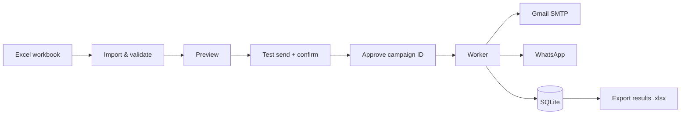
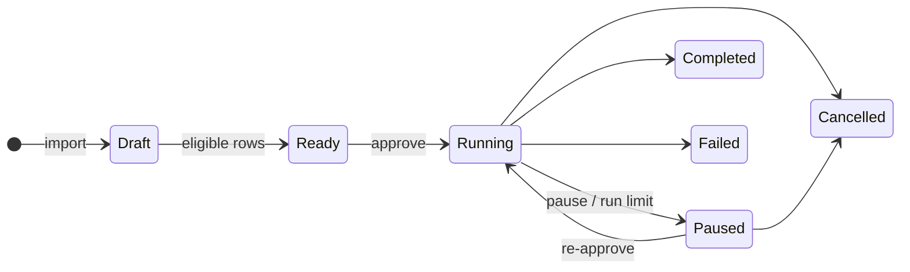

# Message Blaster

Send opted-in campaigns (up to 5,000 recipients) from an Excel workbook through **Gmail** (SMTP + App Password) or **WhatsApp Business** (via [Baileys](https://github.com/WhiskeySockets/docs/blob/main/quickstart.mdx), an unofficial linked-device library). Everything runs locally on SQLite.

> [!WARNING]
> WhatsApp may restrict accounts that use unofficial clients. The rate limits here are safeguards, not guarantees.



## Quick start

Requires Node.js 24.

```bash
npm ci
cp .env.example .env
npm run setup     # creates dirs, runs migrations, generates data/clients.xlsx
npm run web       # dashboard at http://127.0.0.1:3000
```

`DRY_RUN=true` is the default, so nothing is sent until you change it.

## Safety model

Live sending requires all of the following:

1. `DRY_RUN=false` in `.env`
2. A test message sent to yourself and confirmed as received for that sender account
3. `--live --approve <campaign-id>` on the CLI, or typing the campaign ID in the dashboard

Only rows with `Consent Status = Opted In` are sent. Invalid, duplicate or withdrawn recipients are skipped and reported.

## Using the dashboard

1. **New campaign**: pick Gmail, WhatsApp or both, then download the Excel template.
2. **Add recipients**: fill in the workbook and upload it, or switch to **Type in** and enter names with an email or phone number (up to 500; paste rows straight from a spreadsheet). Typed recipients are saved as `Opted In` once you confirm their consent. Set fallback subject, message and attachment for blank cells. Type `{{` to insert a field. With `GROQ_API_KEY` set, **Write** drafts copy with AI.
3. **Import and preview**: check the rendered messages and skipped rows.
4. **Start**: enter the campaign ID to approve it. Pause, cancel, retry and review from the queue.

**Settings** holds Gmail credentials, WhatsApp QR linking and send pacing. Saved settings override `.env` for both the dashboard and the CLI. Keep the dashboard running while a campaign sends.

Attachments are any common format up to 10 MB (executables and scripts are refused). Upload them in **Attachments** and reference them by filename in the workbook.

## Workbook columns

| Column | Gmail | WhatsApp | Notes |
| --- | :-: | :-: | --- |
| Client Name | ✓ | ✓ | Required |
| Email Address | ✓ | | |
| Phone Number | | ✓ | Format as text. Local numbers use `DEFAULT_COUNTRY` |
| Subject | ✓ | | |
| Message | ✓ | ✓ | Falls back to `--template` or the dashboard default |
| PDF Filename / Attachment | ✓ | ✓ | Must exist in the attachments library |
| Consent Status | ✓ | ✓ | Only `Opted In` is sent |
| Campaign ID | ✓ | ✓ | Blank means the row belongs to the selected campaign |

Placeholders: `{{client_name}}`, `{{email_address}}`, `{{phone_number}}`, `{{campaign_id}}`, `{{pdf_filename}}`.

## CLI

### Connect and test

```bash
# Gmail: set GMAIL_USER and GMAIL_APP_PASSWORD in .env first
npm run gmail:test -- gmail-test --email you@example.com --consent
npm run gmail:test -- gmail-test --live --approve gmail-test
npm run gmail:confirm-test -- gmail-test --received

# WhatsApp: scan the QR code under Linked devices
npm run whatsapp:connect
npm run whatsapp:test -- wa-test --phone '+60123456789' --consent
npm run whatsapp:test -- wa-test --live --approve wa-test
npm run whatsapp:confirm-test -- wa-test --received
```

### Run a campaign

```bash
npm run excel:generate -- --channel gmail                 # blank template
npm run campaign:import  -- july --channel gmail --file ./data/gmail-clients.xlsx
npm run campaign:preview -- july
npm run campaign:start   -- july --live --approve july
npm run campaign:status  -- july --attempts
npm run campaign:pause   -- july
npm run campaign:resume  -- july --live --approve july
npm run campaign:cancel  -- july
npm run campaign:export  -- july --output ./storage/july-results.xlsx
```

### Maintenance

```bash
npm run consent:withdraw -- '+60123456789'                 # or an email with --channel gmail
npm run campaign:recover                                   # after a crash
npm run campaign:review -- 42 --outcome SENT --note 'Confirmed'
npm run whatsapp:connect -- --listen                       # collect late delivery/read receipts
npm run db:backup -- ./storage/backup.db
```

Imports are immutable snapshots. To fix a workbook, re-import it under a new campaign ID.

## Lifecycle



Message statuses:

| Status | Meaning |
| --- | --- |
| `SENT` | Accepted by Gmail SMTP or submitted to WhatsApp |
| `DELIVERED` / `READ` | WhatsApp receipt observed |
| `FAILED` | Verified failure. **Retry failed** re-queues it |
| `SKIPPED` | Excluded at import or by consent withdrawal |
| `UNKNOWN` | Outcome uncertain. Never resent automatically. Resolve it with `campaign:review` |

## Configuration

See `.env.example`. Key variables:

| Variable | Default | Purpose |
| --- | --- | --- |
| `DRY_RUN` | `true` | Blocks live delivery |
| `GMAIL_USER` / `GMAIL_APP_PASSWORD` | — | Gmail SMTP credentials ([App Passwords](https://support.google.com/accounts/answer/185833)) |
| `GROQ_API_KEY` / `GROQ_MODEL` | — / `openai/gpt-oss-120b` | AI drafting (hidden when no key is set) |
| `DEFAULT_COUNTRY` | `MY` | Region for local phone numbers |
| `MAX_MESSAGES_PER_RUN` | `100` | Attempts per run, including retries |
| `MESSAGE_DELAY_MS` | `10000` | Spacing between sends |
| `SENDER_CONCURRENCY` | `1` | Parallel sends |
| `MAX_RETRY_ATTEMPTS` / `RETRY_DELAY_MS` | `3` / `5000` | Safe retries with backoff |
| `WEB_PORT` | `3000` | Dashboard port |
| `DATABASE_URL`, `ATTACHMENTS_DIR`, `AUTH_DIR`, `LOG_DIR` | `./storage/...`, `./auth`, `./logs` | Local storage paths |

## Development

```bash
npm run check      # lint + typecheck + unit tests
npm run format     # auto-fix formatting
npm run test:e2e   # Cypress, headless (isolated DB on port 4319, external services stubbed)
npm run cy:open    # Cypress, interactive
```

```
src/
  database/   SQLite connection + migrations
  services/   campaign, message queue, gmail, whatsapp, excel, attachments, ai
  workers/    campaign worker
  web/        dashboard server
web/          dashboard frontend
```

## Privacy

Workbooks, `storage/`, `auth/` and `logs/` may contain personal data and credentials. Git ignores them. Keep them in access-controlled locations.
