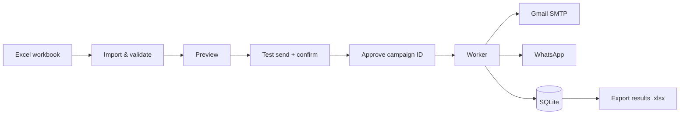
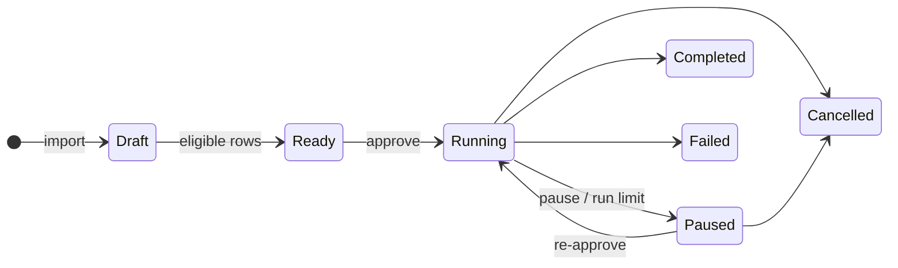

# Message Blaster

Send opted-in campaigns (up to 5,000 recipients) from an Excel workbook through **Gmail** (SMTP + App Password) or **WhatsApp Business** (via [Baileys](https://github.com/WhiskeySockets/docs/blob/main/quickstart.mdx), an unofficial linked-device library). Everything runs locally on SQLite.

> [!WARNING]
> WhatsApp may restrict accounts that use unofficial clients. The rate limits here are safeguards, not guarantees.



## Quick start

Requires Node.js 24.

```bash
npm ci
cp .env.example .env
npm run setup     # creates dirs, runs migrations, generates data/clients.xlsx
```

To open the dashboard, configure Google sign-in as described below and run `npm run web`.

`DRY_RUN=true` is the default, so nothing is sent until you change it.

## Dashboard access

The dashboard requires an approved Google account. The app uses Sign in with Google for operator identity, and campaigns send through the Gmail or WhatsApp account configured in Settings.

1. Configure your project's audience in Google Auth Platform and create an OAuth client of type **Web application**. If your project requires test users, add their accounts there too. [Google OpenID Connect setup](https://developers.google.com/identity/openid-connect/openid-connect)
2. Set the client's **Authorized redirect URI** to `<WEB_PUBLIC_ORIGIN>/auth/callback`, such as `http://localhost:3000/auth/callback` for local use or `https://blaster.example.com/auth/callback` for an HTTPS deployment. Use the exact origin and port that operators will open in their browsers.
3. Set `GOOGLE_CLIENT_ID` and `GOOGLE_CLIENT_SECRET` in `.env` or your process environment. For HTTPS, set `WEB_PUBLIC_ORIGIN=https://blaster.example.com` without a path. The default local origin is `http://127.0.0.1:<WEB_PORT>`.
4. List the Google accounts that may sign in, then start the dashboard and open the configured origin.

```bash
APPROVED_ACCOUNTS="['admin@example.com', 'operator@example.com']"
```

```bash
npm run web
```

Each time the dashboard starts, it applies `APPROVED_ACCOUNTS`: listed accounts can sign in (new ones become administrators; existing ones keep their role), and every other account is disabled and signed out. Restart the dashboard after editing the list. The value can also be written as JSON (`["a@example.com"]`) or comma-separated. Leave it empty to manage accounts with the CLI below instead.

Without `APPROVED_ACCOUNTS`, approve the first administrator with `node --import tsx src/index.ts auth:bootstrap admin@example.com`, then each operator's Gmail or Google Workspace email. On first sign-in the app checks the verified, Google-hosted address and binds the account to its Google subject ID. Thereafter the subject ID identifies the user. Use the dashboard to sign out and the trusted server CLI to manage access.

```bash
node --import tsx src/index.ts auth:invite operator@example.com
node --import tsx src/index.ts auth:invite backup-admin@example.com --role admin
node --import tsx src/index.ts auth:list
node --import tsx src/index.ts auth:revoke operator@example.com
node --import tsx src/index.ts auth:disable operator@example.com
node --import tsx src/index.ts auth:enable operator@example.com
```

Revocation signs the user out. Disabling an account also blocks future sign-ins. The CLI prevents disabling the last enabled administrator. To replace that administrator, approve a second administrator and verify their sign-in first. Run CLI commands under the trusted server account and restrict access to that account and the app files.

### HTTPS deployment

Point the HTTPS reverse proxy at `127.0.0.1:<WEB_PORT>` and preserve the public `Host` header, including a nonstandard port if configured. Forward browser `Origin` unchanged and keep the backend port private. Disable proxy buffering for `/api/events` so campaign updates reach the browser as they happen. Apply per-client rate limits to `/auth/google` and `/auth/callback`. Log paths without query strings and exclude authorization and cookie headers, particularly on `/auth/callback`.

Before upgrading an existing instance, save a SQLite backup using the currently deployed version, and keep a secure copy of the sender encryption key, attachments, and WhatsApp state. Verify the upgrade on a database copy, approve the existing operators, and verify sign-in before sending traffic to the new instance. For a version rollback, restore the pre-upgrade backup to a separate location and run the older dashboard only behind its previous authenticated access boundary. For a restore using the current version, review approved users and run `node --import tsx src/index.ts auth:revoke-all` against the restored database before serving requests. Keep the upgraded database copy to preserve its audit history and later campaign records.

### Audit history

Administrators can open `/audit` to review activity. The SQLite audit trail records the event time, actor when known, action, target, and outcome. It complements the existing operational log in `LOG_DIR`. Back up audit history with the database, and choose a retention period for your deployment. Run the following as a trusted local command or scheduled job to remove expired auth records and audit entries older than the specified period.

```bash
node --import tsx src/index.ts auth:audit-prune --days 90
```

## Safety model

Live sending requires all of the following:

1. `DRY_RUN=false` in `.env`
2. A test sent to yourself and confirmed as received for that sender account (**Settings › Gmail** or **Settings › WhatsApp** › *Test send*)
3. `--live --approve <campaign-id>` on the CLI, or typing the campaign ID in the dashboard

Only rows with `Consent Status = Opted In` are sent. Invalid, duplicate or withdrawn recipients are skipped and reported.

## Using the dashboard

1. **New campaign**: pick Gmail, WhatsApp or both, then download the Excel template. Choosing both creates **one campaign** with one row in the list and one link, such as `/campaigns/customer-renewals`.
2. **Add recipients**: fill in the workbook and upload it, or switch to **Type in** and enter names with an email or phone number (up to 500; paste rows straight from a spreadsheet). Typed recipients are saved as `Opted In` once you confirm their consent. Set fallback subject, message and attachment for blank cells. Type `{{` to insert a field. With `GROQ_API_KEY` set, **Write** drafts copy with AI.
3. **Customize each channel** (both channels only): write the message once in **Shared**, then open **Gmail** or **WhatsApp** to give that channel its own message, attachment or Gmail subject. Each tab shows what it inherits; **Reset to shared** removes the override. Workbook cells still win for rows that fill them in.
4. **Import and preview**: the campaign page opens. **Overview** shows people reached and successful, failed, delivered and read sends; the **Gmail** and **WhatsApp** tabs list each recipient's rendered message, attachment, status, failures and tries.
5. **Send**: type the campaign link name to approve. **Send both** checks both channels first, then sends Gmail and WhatsApp one after the other. If the first channel is paused, cancelled or fails, or the dashboard restarts, the second waits until you send it explicitly. Pause, cancel, retry, review and export per channel.

Counting: **People sent to** counts each person once if any channel accepted their message, so someone reached on both channels is one person but two **successful sends**. Campaigns grouped from older split imports without a shared workbook show per-channel counts instead. Once a channel starts, its content is locked; the other channel stays editable until it is scheduled to send. Renaming changes the display name only, never the link.

**Settings** holds Gmail credentials (the App Password is stored encrypted), WhatsApp QR linking, send pacing and the **Test send** that unlocks campaigns for each sender account. The dashboard and the CLI both read them. Keep the dashboard running while a campaign sends.

Attachments are any common format up to 10 MB (executables and scripts are refused). Upload them in **Attachments** and reference them by filename in the workbook.

## Workbook columns

| Column | Gmail | WhatsApp | Notes |
| --- | :-: | :-: | --- |
| Client Name | ✓ | ✓ | Required |
| Email Address | ✓ | | |
| Phone Number | | ✓ | Format as text. Local numbers use `DEFAULT_COUNTRY` |
| Subject | ✓ | | |
| Message | ✓ | ✓ | Falls back to `--template` or the dashboard default |
| PDF Filename / Attachment | ✓ | ✓ | Must exist in the attachments library |
| Consent Status | ✓ | ✓ | Only `Opted In` is sent |
| Campaign ID | ✓ | ✓ | Blank means the row belongs to the selected campaign |

Placeholders: `{{client_name}}`, `{{email_address}}`, `{{phone_number}}`, `{{campaign_id}}`, `{{pdf_filename}}`.

## CLI

### Connect and test

```bash
# Usually done in Settings › Test send. CLI equivalent:
# Gmail: save the sender in Settings › Gmail first
npm run gmail:test -- gmail-test --email you@example.com --consent
npm run gmail:test -- gmail-test --live --approve gmail-test
npm run gmail:confirm-test -- gmail-test --received

# WhatsApp: scan the QR code under Linked devices
npm run whatsapp:connect
npm run whatsapp:test -- wa-test --phone '+60123456789' --consent
npm run whatsapp:test -- wa-test --live --approve wa-test
npm run whatsapp:confirm-test -- wa-test --received
```

### Run a campaign

```bash
npm run excel:generate -- --channel gmail                 # blank template
npm run campaign:import  -- july --channel gmail --file ./data/gmail-clients.xlsx
npm run campaign:preview -- july
npm run campaign:start   -- july --live --approve july
npm run campaign:status  -- july --attempts
npm run campaign:pause   -- july
npm run campaign:resume  -- july --live --approve july
npm run campaign:cancel  -- july
npm run campaign:export  -- july --output ./storage/july-results.xlsx
```

### Maintenance

```bash
npm run consent:withdraw -- '+60123456789'                 # or an email with --channel gmail
npm run campaign:recover                                   # after a crash
npm run campaign:review -- 42 --outcome SENT --note 'Confirmed'
npm run whatsapp:connect -- --listen                       # collect late delivery/read receipts
npm run db:backup -- ./storage/backup.db
npm run campaign:pairs                                     # report older split -gmail/-whatsapp imports
npm run campaign:group -- launch-gmail launch-whatsapp     # show a confirmed pair as one campaign
```

Upgrading puts every existing campaign on its own page, keeping its ID, history and CLI commands. Older dashboard imports that sent to both channels appear as two campaigns until you confirm them: `campaign:pairs` lists candidates with their evidence (same workbook, created together), and `campaign:group` refuses pairs that only share a name unless you pass `--force`. Back up first with `db:backup`.

Imports are immutable snapshots. To fix a workbook, re-import it under a new campaign ID.

## Lifecycle



Message statuses:

| Status | Meaning |
| --- | --- |
| `SENT` | Accepted by Gmail SMTP or submitted to WhatsApp |
| `DELIVERED` / `READ` | WhatsApp receipt observed |
| `FAILED` | Verified failure. **Retry failed** re-queues it |
| `SKIPPED` | Excluded at import or by consent withdrawal |
| `UNKNOWN` | Outcome uncertain. Never resent automatically. Resolve it with `campaign:review` |

## Configuration

**In the dashboard (Settings):** Gmail sender and [App Password](https://support.google.com/accounts/answer/185833), WhatsApp link, the country for local phone numbers, the pause between messages, and the test send. The App Password is encrypted (AES-256-GCM) with a key kept outside the project at `~/.config/message-blaster/secret.key`. Back that file up with the database; without it the saved password must be entered again. Values still left in an old `.env` are imported once on start.

**In `.env`** (see `.env.example`):

| Variable | Default | Purpose |
| --- | --- | --- |
| `DRY_RUN` | `true` | Blocks live delivery |
| `WEB_PORT` | `3000` | Dashboard port |
| `WEB_PUBLIC_ORIGIN` | `http://127.0.0.1:<WEB_PORT>` | Exact browser origin for sign-in and request validation |
| `GOOGLE_CLIENT_ID` / `GOOGLE_CLIENT_SECRET` | — | OAuth web client for dashboard sign-in |
| `GROQ_API_KEY` / `GROQ_MODEL` | — / `openai/gpt-oss-120b` | AI drafting (hidden when no key is set) |
| `MAX_MESSAGES_PER_RUN` | `100` | Attempts per run, including retries |
| `SENDER_CONCURRENCY` | `1` | Parallel sends |
| `MAX_RETRY_ATTEMPTS` / `RETRY_DELAY_MS` | `3` / `5000` | Safe retries with backoff |
| `SECRET_KEY_FILE` | `~/.config/message-blaster/secret.key` | Encryption key for saved secrets |
| `DATABASE_URL`, `ATTACHMENTS_DIR`, `AUTH_DIR`, `LOG_DIR` | `./storage/...`, `./auth`, `./logs` | Local storage paths |

## Development

```bash
npm run check      # lint + typecheck + unit tests
npm run format     # auto-fix formatting
npm run test:e2e   # Cypress, headless (isolated DB on port 4319, external services stubbed)
npm run cy:open    # Cypress, interactive
npm run bench:campaigns  # list, detail, import and live-update timings at 1,000 and 5,000 recipients
```

```
src/
  auth/         dashboard identities, sessions, and audit history
  cli/          one file per group of CLI commands
  database/     SQLite connection, transactions, migrations
  store/        everything saved about campaigns: Store class + one module per area
  services/     campaign/, excel/, whatsapp/, gmail, attachments, settings, ai
  workers/      the campaign send loop and payload preparation
  web/          dashboard server: http helpers, live updates, input/ parsing, routes/
  errors.ts     NotFoundError / ConflictError, mapped to HTTP 404 / 409
web/            dashboard frontend
  shared/       DOM and request helpers, icons, labels
  campaigns/    campaign list, campaign page (overview + channel tabs), action buttons
  compose/      new/edit campaign dialog, recipients, attachments, AI writer
  editor/       message editor and placeholder menu
  settings/     settings dialog, Gmail/WhatsApp/test-send panels
  viewer/       attachment preview
  dialogs/      confirmation dialog
```

Functions are kept short (a few lines) and named for what they do, so a file reads top to bottom: the exported entry point first, then the steps it calls.

## Privacy

Workbooks, `storage/`, `auth/` and `logs/` may contain personal data and credentials. Git ignores them. Keep them in access-controlled locations.
